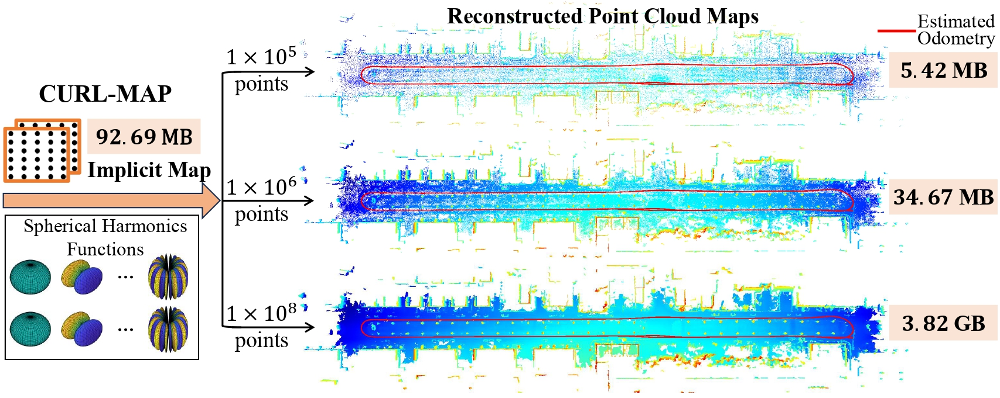
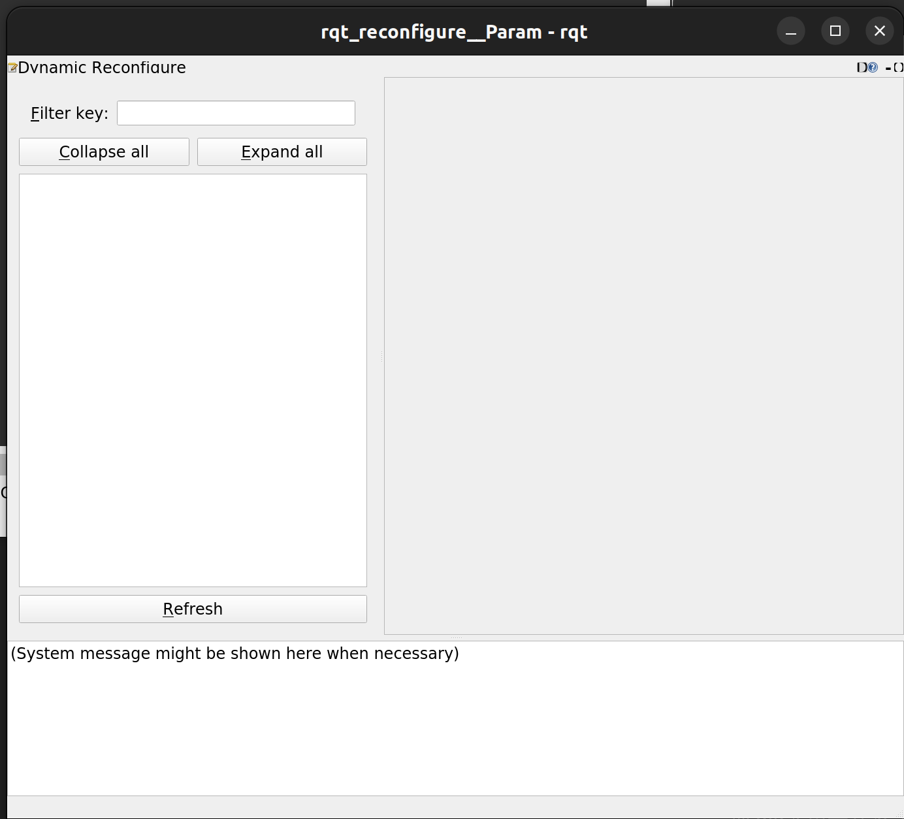
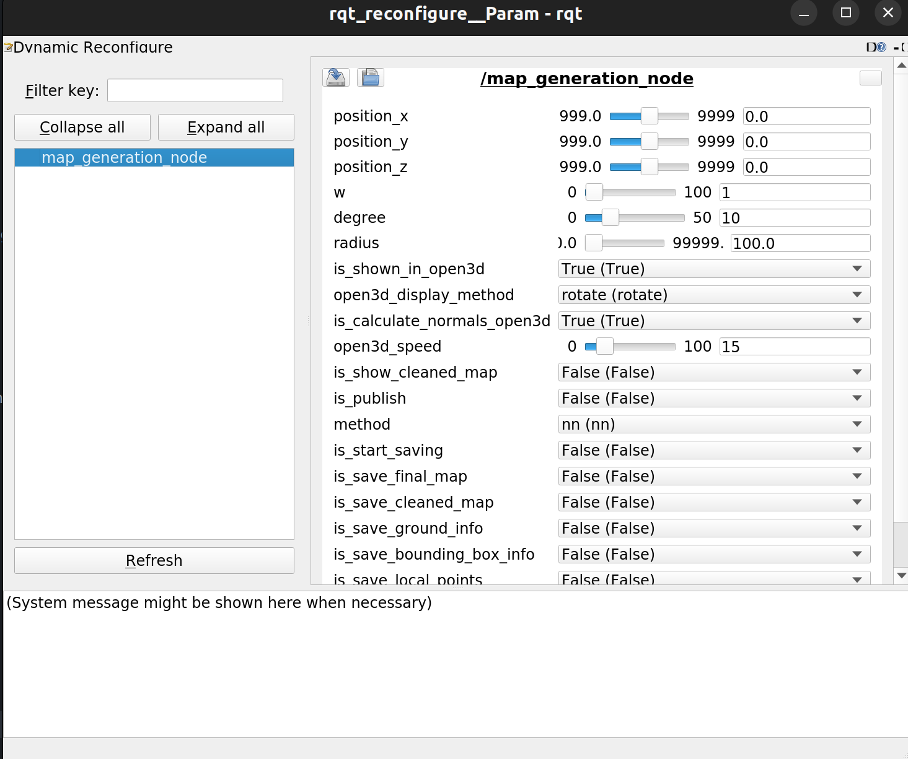
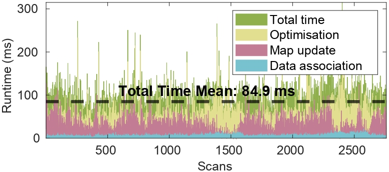

# CURL-MAP ([Paper](https://ieeexplore.ieee.org/document/10610760))

We extend the continuous reconstruction and memory efficiency advantages of [CURL](https://github.com/SenseRoboticsLab/CURL) to large-scale maps, introducing new capabilities for odometry and updatable mapping.

<p align="center">

</p> 
With the same CURL-MAP, can produce different resolutions of reconstruction.

# Build and Run (Ubuntu System)

```
git cloue https://github.com/SenseRoboticsLab/CURL-MAP.git
cd CURL-MAP
```

## I. Docker Setup

1. Build the image

> CPU only

```
sudo docker build -f ./docker/curl_map_cpu.dockerfile --build-arg NUM_THREADS=12 -t curl_map:v0 .
```

> With Nvidia GPU, can speed up rivz visualization

```
sudo docker build -f ./docker/curl_map_gpu.dockerfile --build-arg NUM_THREADS=12 -t curl_map:v0 .
```

2. Enabling X Server Access with

```
xhost +
```

3. Create a container

Please fill `<directory on your host machine>` in the following commands

> CPU only

```
sudo docker run --name curl_map_container -it -e DISPLAY=$DISPLAY -e QT_X11_NO_MITSHM=1 -v /tmp/.X11-unix:/tmp/.X11-unix:rw --volume="$HOME/.Xauthority:/root/.Xauthority:rw" --network host --add-host host.docker.internal:host-gateway -v <directory on your host machine>:/home/user/data curl_map:v0 /bin/bash
```

> With Nvidia GPU

```
sudo docker run --name curl_map_container -it --privileged --gpus all -e="NVIDIA_VISIBLE_DEVICES=all" -e="NVIDIA_DRIVER_CAPABILITIES=graphics,compute,utility" -e DISPLAY=$DISPLAY -e QT_X11_NO_MITSHM=1 -v /tmp/.X11-unix:/tmp/.X11-unix:rw --volume="$HOME/.Xauthority:/root/.Xauthority:rw" --network host --add-host host.docker.internal:host-gateway -v <directory on your host machine>:/home/user/data curl_map:v0 /bin/bash
```

4. Create a new terminal inside the container

```
sudo docker exec -it curl_map_container /bin/bash
```

## II. Run CURL-MAP (program depends on config.yaml)

1. Run CURL-MAP for Livox

```
roslaunch --sigint-timeout=60000 --sigterm-timeout=60000 curl_slam curl_slam.launch
```

2. Publish example data

```
roslaunch patchworkpp run_patchwork_kitti.launch data_dir:=/home/user/catkin_ws/src/CURL-MAP/example_data/kitti/sequences seq:=05
```

3. Publish rosbag data

Modify the LiDAR topic name inside `/home/user/catkin_ws/src/patchwork-plusplus-ros-modified/launch/demo_newer_college.launch`

```
roslaunch patchworkpp demo_newer_college.launch
```

```
rosbag play <your rosbag>
```

## III. Load Map (program depends on config.yaml)

```
roslaunch curl_slam curl_reconstruction.launch
```

Click refresh button like the image shows

<p align="center">

</p>

Then `w` and `degree` can be used to adjust density and detail of the reconstruction respectively.
<p align="center">

</p>

# ToDo

- [ ] Clean the config file, remove useless parameters
- [ ] Add comments for parameters
- [ ] Clean the code

# Results

### 1. Continuous Reconstruction

<p align="center">

</p>

> Newer College Dataset

<p align="center">

</p>

> KITTI Dataset

<p align="center">

</p>

### 2. Odometry and Mapping

<p align="center">

</p>
<p style="text-align: center;">KITTI-05</p>

## Time Analysis

CURL-MAP is able to achieve real-time performance on a CPU in the FAST mode.

<p align="center">

</p>

# Acknowledgments

The **conformal parameterisation** module in this project is a C++ reimplementation of the original MATLAB code from  
[garyptchoi/rectangular-conformal-map](https://github.com/garyptchoi/rectangular-conformal-map),  
which is licensed under the [Apache License 2.0](https://www.apache.org/licenses/LICENSE-2.0).
